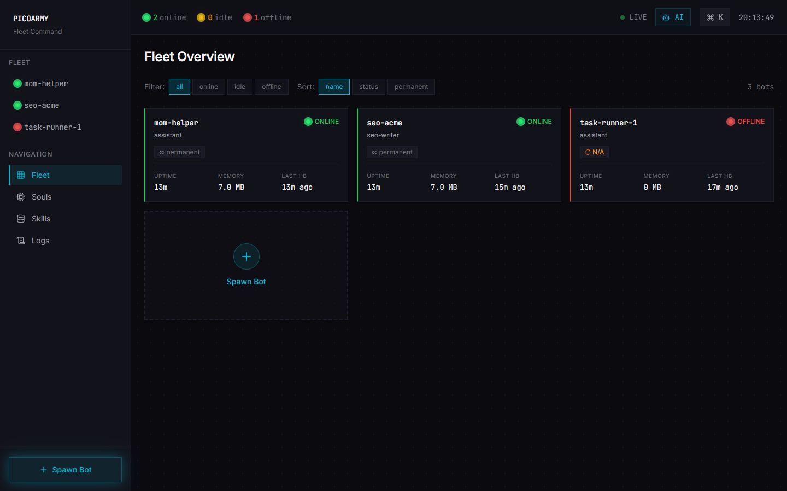

# PicoArmy — Fleet Command Center

> A PostgreSQL-first management layer for [louisho5/picobot](https://github.com/louisho5/picobot) fleets — spawn and orchestrate self-hosted AI agents from a single container.

[](LICENSE)
[](https://www.typescriptlang.org/)
[](https://www.postgresql.org/)
[](https://react.dev/)
[](https://modelcontextprotocol.io/)

<p align="center">
  
  <br><em>Fleet overview from a local run on 2026-11-05. The three bots are the sample rows <code>init-db/01-schema.sql</code> inserts; no picobot workload was attached for the capture.</em>
</p>

PicoArmy is a management layer for [picobot](https://github.com/louisho5/picobot), a small Go chatbot that speaks any OpenAI-compatible API. One Docker host runs a Node.js service, the Commander, that spawns bots as child processes, keeps the fleet registry in PostgreSQL, serves a React dashboard, and proxies Model Context Protocol tools to the bots. Postgres is the source of truth: fleet state, telemetry and the MCP audit log live in SQL tables with row-level security, and PostgREST exposes them as a REST API.

**Status.** Working project, no releases. As of 2026-11-05 the stack builds and starts from `docker compose up -d` and serves the dashboard and fleet API (checked locally; see Getting Started). It has no automated test suite in the repository, and I have not measured how many bots a host can carry.

## What it does

- **Fleet management.** Spawn, configure and destroy picobot instances as child processes of the Commander, with no Docker-in-Docker. Permanent bots restart from the database registry; ephemeral bots tear down after a TTL.
- **Swarms.** Chain specialised bots into pipelines through the Commander meta-agent.
- **PostgreSQL first.** Business logic lives in SQL functions, triggers and row-level security. PostgREST generates the REST API from the `api` schema.
- **MCP hub.** The Commander proxies MCP tools to the fleet with per-client scope enforcement and an audit log of every call.
- **Dashboard.** React 19 with server-sent-event telemetry, fleet health, a command palette and a dark terminal look.
- **Souls and skills.** Versioned `SOUL.md` personalities and skill packages, deployable to one bot or the whole fleet.

## Architecture

```
┌─────────────────────────────────────────────────────────────┐
│  Commander (Node.js/Express)            :4000               │
│  ├── Dashboard (Vite React)             /                   │
│  ├── Fleet API                          /api/fleet          │
│  ├── MCP Hub                            /api/tools          │
│  ├── SSE Telemetry                      /api/sse            │
│  └── Process Manager                                        │
│       ├── mom-helper     (permanent, workspace: data/bots/) │
│       ├── seo-acme       (permanent, client_id: acme)       │
│       └── task-runner-1  (ephemeral, TTL=2h)                │
├─────────────────────────────────────────────────────────────┤
│  MCP Servers (stdio, Coding Plan keys)                      │
│  ├── Z.AI    (vision, web search, GitHub)                   │
│  └── MiniMax (TTS, video, image generation)                 │
├─────────────────────────────────────────────────────────────┤
│  PostgreSQL 15          :5432                                │
│  ├── api.bots           (fleet registry + RLS)              │
│  ├── api.telemetry      (JSONB activity logs + RLS)         │
│  ├── api.mcp_tool_calls (audit log + RLS)                   │
│  └── api.updates        (firmware versioning)               │
├─────────────────────────────────────────────────────────────┤
│  PostgREST 14           :3000                                │
│  └── Auto-REST from api schema                              │
└─────────────────────────────────────────────────────────────┘
```

## Getting Started

**Prerequisites:** [Docker](https://www.docker.com/) + Docker Compose, [Node.js](https://nodejs.org/) 20+, and the [picobot](https://github.com/louisho5/picobot) binary on your `PATH` (only needed to actually run bots).

```bash
# 1. Configure environment: copy the template and set POSTGRES_PASSWORD
#    (compose refuses to start without it); the rest is optional
cp .env.example .env

# 2. Start Postgres, PostgREST and the Commander (dashboard included)
docker compose up -d        # Postgres :5432, PostgREST :3000, Commander :4000

# 3. Open the dashboard
open http://localhost:4000
```

I ran steps 1 and 2 on Windows with Docker Desktop on 2026-11-05. `GET /api/fleet` returned the three sample bots, the dashboard rendered as in the capture above, and `GET /api/mcp/status` reported the MCP servers as errored or disconnected because no provider keys were set. Running the Commander on the host instead (`npm install`, `npm run build:dashboard`, `npm run dev` against the compose database) is the development path; I did not run it for this update.

PostgREST API is at `http://localhost:3000`. Commander API is at `http://localhost:4000/api`.

## API Endpoints

| Method | Endpoint | Purpose |
|--------|----------|---------|
| `GET` | `/api/fleet` | List all bots |
| `POST` | `/api/fleet` | Spawn a new bot |
| `DELETE` | `/api/fleet/:id` | Destroy a bot |
| `PATCH` | `/api/fleet/:id/settings` | Update bot config (provider, model, client_id, telegram) |
| `POST` | `/api/fleet/:id/soul` | Deploy soul template (`{soul_name}`) or edit directly (`{content}`) |
| `GET` | `/api/fleet/:id/soul` | Get bot's current soul content |
| `POST` | `/api/fleet/:id/command` | Send command to bot via COMMANDS.md |
| `GET` | `/api/fleet/:id/skills` | List skills deployed to a bot |
| `POST` | `/api/fleet/:id/skills` | Deploy a skill to a bot |
| `DELETE` | `/api/fleet/:id/skills/:name` | Remove skill from bot |
| `GET` | `/api/skills` | List available skills library |
| `GET` | `/api/souls` | List available soul templates |
| `GET` | `/api/providers` | List configured LLM provider presets |
| `GET` | `/api/tools` | List MCP tools (filter: `?bot=name`) |
| `POST` | `/api/tools/:name/call` | Execute MCP tool (body: `{arguments, bot_name}`) |
| `GET` | `/api/mcp/status` | MCP hub connection status |
| `GET` | `/api/sse` | Server-Sent Events stream |

## MCP Tool Integration

Commander acts as a universal MCP client hub. Bots request tools via `HEARTBEAT.md`, Commander proxies through connected MCP servers with scope enforcement.

**Connected servers** (configured in `mcp-servers.json`, both use Coding Plan keys):
- **Z.AI** (`@z_ai/mcp-server`) — Vision analysis, web search, GitHub exploration (GLM-4.6V powered). Uses `GLM_CODING_API_KEY`.
- **MiniMax** (`minimax-mcp`) — Text-to-speech, video generation, image generation. Uses `MINIMAX_API_KEY` from Coding Plan.

**Scope guard**: Tools scoped `"shared"` are available to all bots. Tools scoped `"client:<id>"` are restricted to bots with matching `client_id`.

## IPC Channels

Bots are Go processes with no HTTP API. Communication is via filesystem:

| File | Owner | Direction | Purpose |
|------|-------|-----------|---------|
| `HEARTBEAT.md` | Bot | Bot → Commander | Tool requests (polled every 10s) |
| `COMMANDS.md` | Commander | Commander → Bot | Commands (appended, read on next tick) |
| `TOOL_RESULT_{id}.json` | Commander | Commander → Bot | Tool call results |
| `config.json` | Commander | Commander → Bot | LLM and Telegram config |
| `workspace/SOUL.md` | Commander | Commander → Bot | Agent personality |

Channels are separated to prevent race conditions between tool requests and commands.

## Security

- **RLS (Row Level Security):** Enabled on `api.bots`, `api.telemetry`, and `api.mcp_tool_calls`. Policies filter rows by `x-client-id` request header via `api.get_client_id()`. Commander (no header) sees all rows; clients see only their scoped data.
- **MCP Scope Guard:** Tool access is enforced per `client_id` — bots scoped to client A cannot invoke tools restricted to client B.
- **Audit Logs:** All MCP tool calls are logged to `api.mcp_tool_calls` with bot, tool, arguments, result, and duration.
- **Zombie Reaping:** On startup, Commander kills orphaned bot processes from previous sessions via persisted PID files in `data/pids/`.

## LLM Provider Presets

Two tiers: **Groq free tier** (zero cost, rate-limited) and **Coding Plan** (flat monthly).

### Groq Free Tier — Speed + Zero Cost

| Preset | Model | Tokens/Day | Best For |
|--------|-------|-----------|----------|
| `groq-scout` | Llama 4 Scout 17B | 500K | Commander chat, smart bots |
| `groq-maverick` | Llama 4 Maverick 17B | 500K | Multilingual bots (12 langs) |
| `groq-instant` | Llama 3.1 8B | 500K (14.4K req/day) | High-volume lightweight bots |
| `groq-qwen` | Qwen3 32B | 500K (60 RPM) | Burst workloads, Chinese |
| `groq-kimi` | Kimi K2 | 300K (60 RPM) | Long reasoning tasks |
| `groq-70b` | Llama 3.3 70B | 100K | Tool/function calling |

### Coding Plan — Flat Monthly, No Rate Limits

| Preset | Model | Format | Plan |
|--------|-------|--------|------|
| `glm-flash` | GLM-4.7-Flash | OpenAI | Coding Plan (free tier) |
| `glm-coding` | GLM-4.7 | OpenAI | Coding Plan (~$3-15/mo) |
| `minimax` | MiniMax-M2.1 | OpenAI | Coding Plan (~$10-50/mo) |
| `minimax-anthropic` | MiniMax-M2.1 | Anthropic | Same key, Anthropic format |

**Strategy:** Groq for speed-first bots (chat, assistants). GLM-Flash as unlimited fallback. Coding plan models for heavy/sustained workloads.

## Tech Stack

| Layer | Technology |
|-------|-----------|
| Database | PostgreSQL 15 + RLS |
| API | PostgREST 14 (auto-REST) |
| Commander | TypeScript + Express |
| MCP | @modelcontextprotocol/sdk |
| Dashboard | Vite + React + Zustand + Radix UI |
| Agent | louisho5/picobot (Go, ~8MB) |
| Infra | Docker Compose (dev) / Docker (production) |

## Production Deployment

PicoArmy runs as a **single Docker container** with all components inside:

```
One Container: picoarmy
├── PostgreSQL 15      (internal :5432)
├── PostgREST          (internal :3000)
├── Commander          (public   :4000)
└── N × picobot        (child processes)

Volume: /data/
├── postgres/          (PostgreSQL data)
├── bots/{name}/       (bot workspaces)
└── pids/              (process tracking)
```

### Build & Run

```bash
# Build the image
docker build -t picoarmy:latest .

# Run the container
docker run -d \
  --name picoarmy \
  -p 4000:4000 \
  -v picoarmy-data:/data \
  -e POSTGRES_PASSWORD=<secure-password> \
  -e JWT_SECRET=<min-32-chars> \
  picoarmy:latest
```

### Environment Variables

Required:
- `POSTGRES_PASSWORD` — PostgreSQL password
- `JWT_SECRET` — PostgREST JWT secret (min 32 chars)

Optional:
- `POSTGRES_DB` (default: `picoarmy`)
- `POSTGRES_USER` (default: `commander`)
- `PORT` (default: `4000`)

The image is self-contained — point it at any Docker host (a plain `docker run`, Docker Swarm, or a PaaS such as [Dokploy](https://dokploy.com/) / Coolify with a reverse proxy to port `4000`). On startup, permanent bots auto-spawn from the DB registry.

## Contributing

Contributions are welcome. Please open an issue to discuss substantial changes first, then submit a pull request. See [CONTRIBUTING.md](CONTRIBUTING.md) for development setup and conventions.

## Credits

PicoArmy is a management layer for [**louisho5/picobot**](https://github.com/louisho5/picobot) — the lightweight Go AI chatbot it orchestrates. All credit for the agent runtime goes to the picobot project.

## License

[MIT](LICENSE) © Pascal Ledesma
