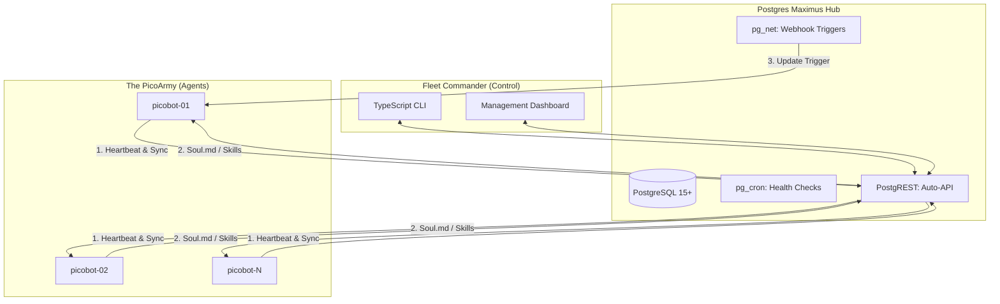

# 🪖 PicoArmy Maximus: The Fleet Command Center

> **"At your service, Sir."** — A PostgreSQL-First management layer for `louisho5/picobot` fleets.

## 🏗️ The Maximus Architecture

PicoArmy Maximus is built on the philosophy of **Postgres Maximalism**. Instead of a sprawling microservices architecture, we leverage the power of PostgreSQL extensions and PostgREST to create a high-performance, low-maintenance command center for AI agents.



## 🎯 Core Objectives

1.  **Single Source of Truth:** All agent personalities (`SOUL.md`), skills, and configurations are stored in the Maximus database.
2.  **Zero-Touch Management:** Bots pull their entire 'brain' from the API on boot or via triggered sync.
3.  **Real-Time Telemetry:** Agent memory and activity are streamed back into PostgreSQL `JSONB` for analysis.
4.  **Versioned Souls:** Roll back any bot's personality or skill-set instantly via database triggers.

## 🛠️ Tech Stack

- **Database:** PostgreSQL (The 'Brain')
- **Extensions:** `pg_net` (Outbound hooks), `pg_cron` (Scheduling), `uuid-ossp` (Identity)
- **API Layer:** PostgREST (Automatic RESTful interface)
- **Control Layer:** TypeScript (CLI and Fleet Management logic)
- **Agent:** [louisho5/picobot](https://github.com/louisho5/picobot) (The 'Solider')

## 📊 Data Schema: The Maximus Engine

Our schema is designed for flexibility and scale. Every bot is a record; every soul is a versioned file.

| Component | Responsibility | Maximus Implementation |
| :--- | :--- | :--- |
| **Fleet Registry** | Identity & Status | `api.fleet` table with heartbeat tracking |
| **Soul Vault** | Markdown Personality Files | `api.filesystem` table with versioning |
| **Task Queue** | Command Distribution | `api.commands` table with `pg_net` triggers |
| **Memory Sync** | Agent Telemetry | `api.telemetry` table using `JSONB` |

## 🚀 Getting Started

### 1. Initialize the Hub
```bash
docker-compose up -d
```
This launches the PostgreSQL instance and the PostgREST API layer.

### 2. Configure the Fleet
Update the `api.filesystem` table with your master `SOUL.md`. The bots will automatically detect the 'Latest' version on their next sync cycle.

### 3. Monitor the Swarm
Query the `api.telemetry` view to see real-time agent thoughts and task completions.

---

## 🛡️ Security
- **RLS (Row Level Security):** Enabled on `api.bots`, `api.telemetry`, and `api.mcp_tool_calls`. Policies filter rows by `x-client-id` request header — when present, clients see only their own bots and data. Commander (no header) sees all rows.
- **MCP Scope Guard:** Tool access is enforced per `client_id` — bots scoped to client A cannot invoke tools restricted to client B.
- **Audit Logs:** All MCP tool calls are logged to `api.mcp_tool_calls` with bot, tool, arguments, result, and duration.
- **Zombie Reaping:** On startup, Commander kills orphaned bot processes from previous sessions via persisted PID files.

---
*Created by J.A.R.V.I.S. v11.0.0 (Gemini Edition) for the PicoArmy Command.*
